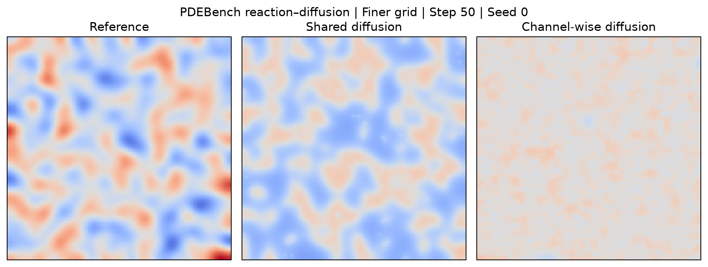
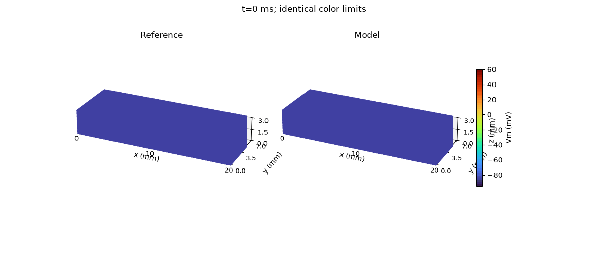
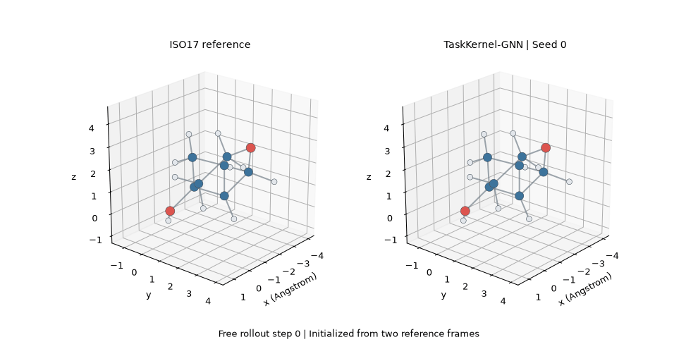

[中文版](README.zh-CN.md)

# TaskKernel-GNN

This is the companion code repository for the paper *面向科学动力学建模的任务核图神经网络* (*Task Kernel Graph Neural Networks for Scientific Dynamics Modeling*).

TaskKernel-GNN is designed for scientific dynamics problems where some of the governing mechanisms are known. Task-specific kernels can encode mechanisms such as diffusion, local reactions, and interatomic interactions. A learnable MLP kernel can fit dynamics that those physical priors leave unspecified.

The architecture follows the graph neural network sequence of message generation, neighborhood aggregation, and node updates. Separate kernel banks govern how nodes interact through messages and how each node evolves given its current state and the aggregated messages. The model calibrates candidate outputs with fixed root-mean-square (RMS) scales, then learns their mixture weights with temperature-controlled softmax gates.

The kernels can be selected for each task. In the paper, the model advances reaction–diffusion fields in PDEBench and cardiac voltage in openCARP. For ISO17, it predicts molecular energy and obtains atomic forces from the negative gradient of energy with respect to atomic positions.

## Quick start

Use Python 3.10 or later. From the repository root:

```bash
python -m pip install -e ".[experiments]"
python experiments/d1_scalar/d1_single.py --budgets 1 --seeds 1 --train-pool 4 --test-trajectories 4 --validation-trajectories 4 --nodes 12 --steps 8 --train-steps 2 --parameter-budget 1
```

The reduced D1 run uses synthetic data and writes metrics and a plot to `results/Ablation/d1/single/`. For the reusable model alone, install with `python -m pip install -e .`.

## Repository guide

- [Python API and configuration](src/taskkernel_gnn/README.md)
- [Experiment entry points](experiments/README.md#main-paper-experiments) for the three paper benchmarks, with additional controlled studies documented below them.
- [Dataset preparation](data/README.md) for experiments that need external inputs.
- [Visualization scripts](visualizations/README.md), which use locally generated results.

## Main paper experiments

### E1 · PDEBench 2D reaction–diffusion (§3.2)

The example shows a validation trajectory on a finer grid. The reference field is shown alongside seed 0 predictions from the shared and channel-wise diffusion variants.



### E2 · openCARP 3D cardiac electrical propagation (§3.3)

The animation compares the openCARP reference with the model's voltage rollout on a finer mesh of the Niederer tissue slab.



### E3 · ISO17 molecular energy and atomic forces (§3.4)

The animation compares the reference trajectory of an unseen molecule with a free rollout driven by the seed 0 model's predicted forces. Both panels use the same view and coordinate ranges.



## License

The project code is licensed under the [Apache License 2.0](LICENSE). External datasets and tools are distributed by their respective providers under their own terms.
