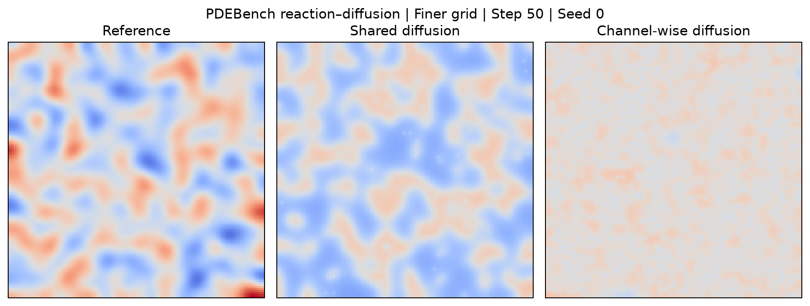
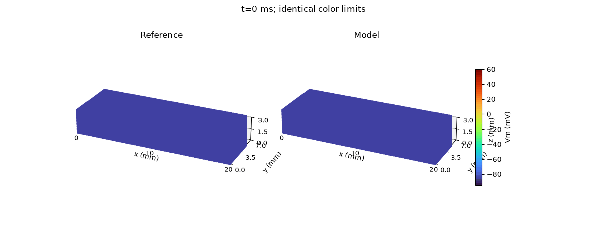
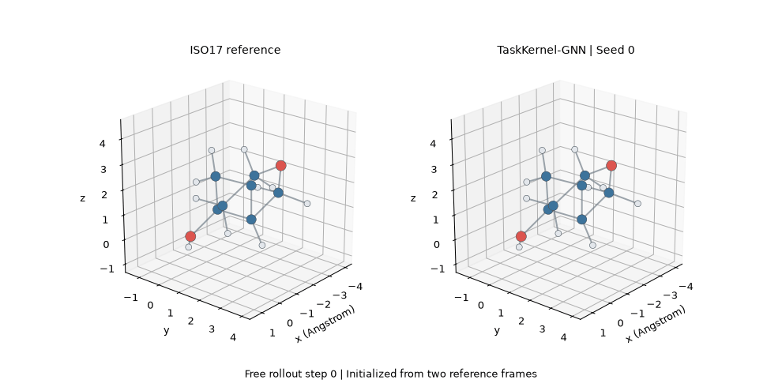

[English](README.md)

# TaskKernel-GNN

本仓库是论文《面向科学动力学建模的任务核图神经网络》的配套开源代码库。

TaskKernel-GNN 面向带有部分已知物理机制的科学动力学任务。扩散、局部反应和原子间相互作用等已知机制可以写成与任务相关的候选核，未被先验覆盖的部分则由可学习的 MLP 补全核从数据中拟合。

模型沿用图神经网络的消息生成、邻域聚合和节点更新流程，在消息生成和节点更新阶段分别设置候选核库。消息核描述节点之间如何相互作用，更新核描述节点如何结合自身状态与聚合消息演化。模型以固定的均方根（RMS）尺度校准候选核的输出，再通过带温度参数的 Softmax 门控学习各核的混合权重。

候选核可随任务组合。论文在 PDEBench 和 openCARP 中用模型推进反应–扩散场和心肌电位，在 ISO17 中则预测分子能量，并由能量对原子坐标的负梯度得到原子力。

## 快速开始

使用 Python 3.10 或更高版本，在仓库根目录运行：

```bash
python -m pip install -e ".[experiments]"
python experiments/d1_scalar/d1_single.py --budgets 1 --seeds 1 --train-pool 4 --test-trajectories 4 --validation-trajectories 4 --nodes 12 --steps 8 --train-steps 2 --parameter-budget 1
```

这条命令运行缩小规模的 D1 合成数据实验，在 `results/Ablation/d1/single/` 生成指标和图表。只安装模型库可运行 `python -m pip install -e .`。

## 项目导航

- [Python API 与配置说明](src/taskkernel_gnn/README.zh-CN.md)
- [实验入口](experiments/README.zh-CN.md#论文主实验)，先列论文的三个主实验，再列受控实验。
- [数据准备](data/README.md)，说明外部数据的来源与准备方式。
- [可视化脚本](visualizations/README.zh-CN.md)，使用本地生成的实验产物。

## 论文主实验

### E1 · PDEBench 二维反应–扩散（第 3.2 节）

该示例取自一条验证轨迹，展示更细网格上的参考场，以及共享扩散系数和分通道扩散系数两种模型在 seed 0 下的预测场。



### E2 · openCARP 三维心肌电传导（第 3.3 节）

动画并排展示 Niederer 长方体心肌组织在更细网格上的 openCARP 参考电位和模型预测电位。



### E3 · ISO17 分子能量与原子力预测（第 3.4 节）

动画并排展示未见分子的参考轨迹，以及 seed 0 模型用预测原子力自由推进得到的轨迹。两侧使用相同的视角和坐标范围。



## 许可证

项目代码采用 [Apache License 2.0](LICENSE)。外部数据与工具适用各自提供方的条款。
